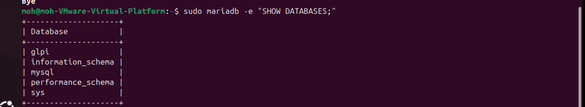
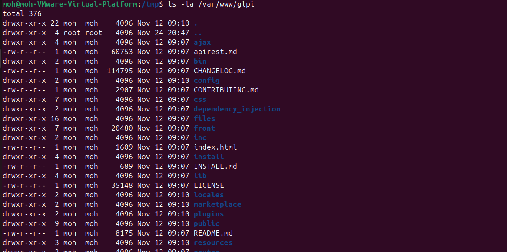
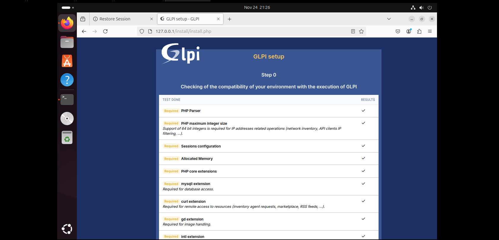
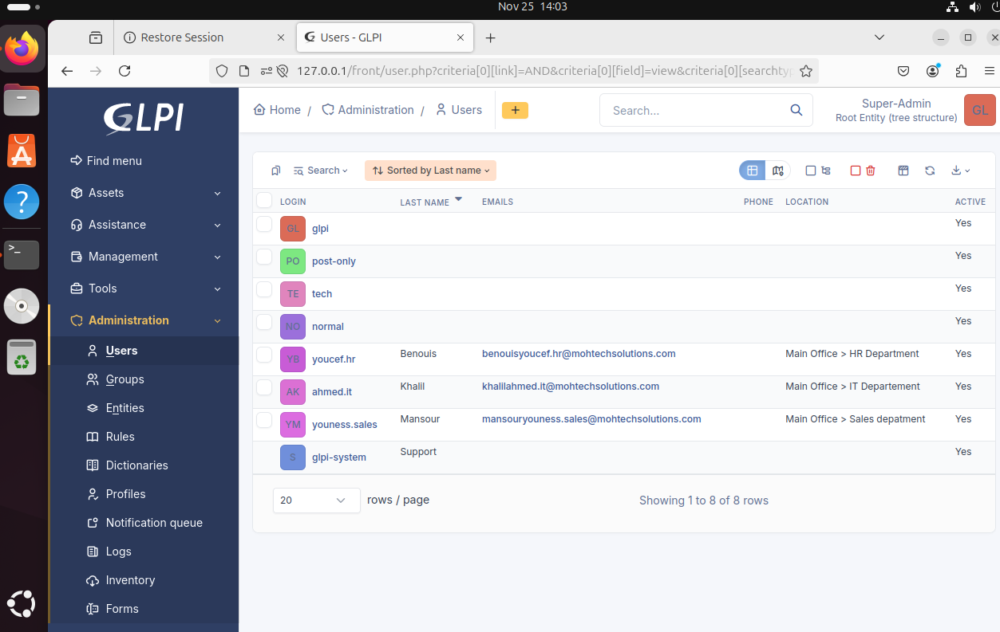
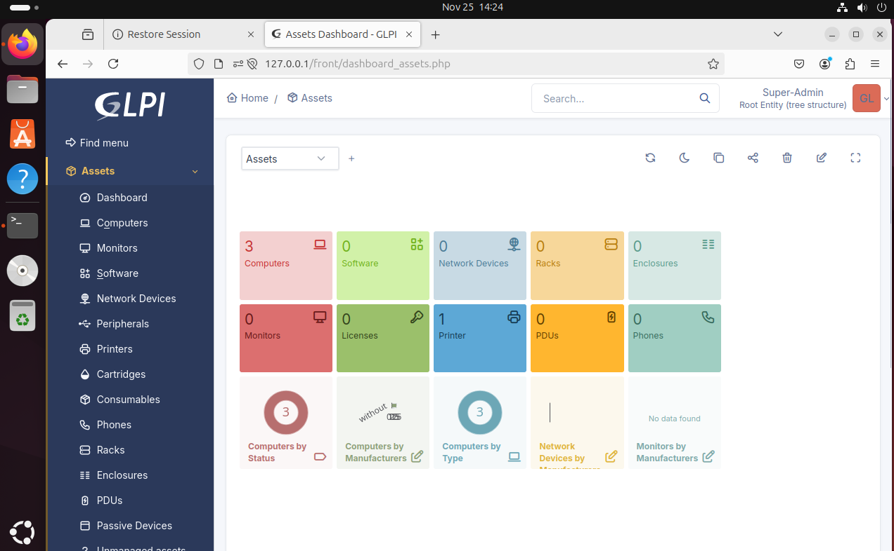
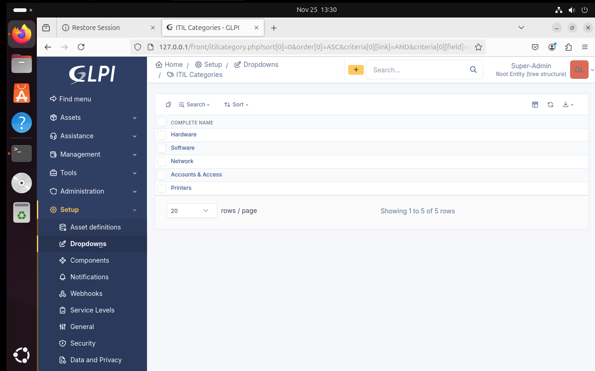
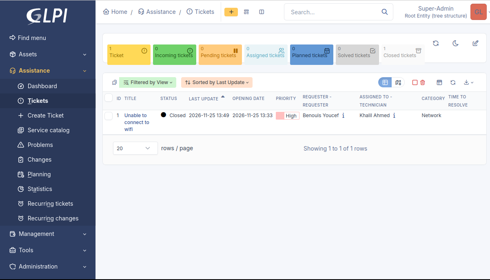

# GLPI Helpdesk & IT Asset Management

### MOHTECH Solutions | IT Support & Infrastructure


---

## Overview

A hands-on IT infrastructure project focused on deploying and configuring **GLPI**, an open-source IT Service Management (ITSM), helpdesk, and IT asset management platform.

Built around the MOHTECH Solutions company scenario, this project demonstrates the deployment of a Linux-hosted helpdesk environment and the configuration of common IT support workflows.

The implementation covers:

- Ubuntu Linux environment preparation.
- Apache2 web server configuration.
- MariaDB database deployment.
- PHP installation and configuration.
- GLPI deployment and installation.
- Organizational structure and user management.
- IT asset inventory.
- Ticket categorization and incident management.
- Complete support ticket resolution workflow.

The objective was to build a functional helpdesk environment reflecting the practical responsibilities of an organization's IT support department.

## Technology Stack

| Technology | Purpose |
|---|---|
| Ubuntu Desktop 24.04.5 LTS | Linux environment hosting GLPI |
| GLPI 12.0.2 | Helpdesk and IT asset management |
| Apache2 | Web server |
| PHP 8.3.6 | Application runtime |
| MariaDB 10.11.14 | Relational database |
| VMware Workstation | Virtualization |
| Bridged Networking | Network connectivity |

## Infrastructure Architecture

GLPI runs on an Ubuntu virtual machine. Apache2 handles web requests, PHP executes the application, and MariaDB stores application data.

```text
             MOHTECH SOLUTIONS
              Employees / IT
                    |
               Web Browser
                    |
             Ubuntu Linux VM
                GLPI 12.0.2
                    |
                 Apache2
                    |
                   PHP
                    |
                 MariaDB
               GLPI Database
```

---

# 1. Linux Environment & Server Deployment

Prepared an Ubuntu Desktop 24.04.5 LTS virtual machine using VMware Workstation.

The network adapter was configured using bridged networking to allow the virtual machine to communicate with devices on the local network.

## 1.1 Apache2 Web Server

Installed Apache2 to host the GLPI web application and verified that the web server was operational by accessing its default page.


Configured Apache2 with a dedicated VirtualHost for GLPI.

The application was configured to use the following document root:

`/var/www/glpi/public`

This ensures that Apache serves the public application directory rather than exposing the entire GLPI installation directory.

## 1.2 Web Server and Database Services

Installed MariaDB as the database server required by GLPI.

Verified that both Apache2 and MariaDB services were running correctly.


## 1.3 MariaDB Database Configuration

Created a dedicated MariaDB database for the GLPI application.

| Setting | Value |
|---|---|
| Database Server | MariaDB |
| Database Name | `glpi` |
| Database User | `glpi_user` |
| Purpose | GLPI application data |

Verified the database through the MariaDB command-line interface.



Database credentials are not included in this repository.

## 1.4 PHP Installation

Installed PHP 8.3.6 along with the extensions required by GLPI.

Verified the installed PHP version before proceeding with the application deployment.


## 1.5 GLPI Application Deployment

Downloaded and extracted GLPI 12.0.2 into the application directory:

`/var/www/glpi`



Configured application directory ownership and permissions for the Apache service account (`www-data`).

This allows Apache to access the required GLPI configuration and storage directories.


## 1.6 Apache VirtualHost & Local Access

Configured the Apache VirtualHost to serve GLPI through its public directory.

Accessed the application through the local web interface to verify the Apache configuration.


## 1.7 GLPI Installation

Completed the GLPI installation process and checked the environment requirements before connecting the application to MariaDB.



Connected GLPI to the previously created database and completed the installation.


## 1.8 GLPI Login & Dashboard

After installation, accessed the GLPI login interface and verified that the application was available.


Successfully accessed the GLPI dashboard.


---

# 2. Organizational Structure & User Management

Configured GLPI to represent the organizational structure of MOHTECH Solutions.

## 2.1 Locations and Departments

Created a location hierarchy to organize employees and company equipment.

```text
Main Office
|
|-- IT Department
|
|-- HR Department
|
|-- Sales Department
```

Configured the locations and departments within GLPI.


## 2.2 User Accounts

Created three user accounts representing employees from different departments and an IT technician responsible for handling support requests.

| Username | Name shown in GLPI | Email | Department | Access |
|---|---|---|---|---|
| `youcef.hr` | Benouis | `benouisyoucef.hr@mohtechsolutions.com` | HR | Self-Service |
| `youness.sales` | Mansour | `mansouryouness.sales@mohtechsolutions.com` | Sales | Self-Service |
| `ahmed.it` | Khalil | `khalilahmed.it@mohtechsolutions.com` | IT | Hotliner profile with additional Technician authorization |

Configured user accounts, departmental locations, and the appropriate access authorizations.



## 2.3 Employee Self-Service Access

Verified that an HR employee could log in through the GLPI Self-Service interface.

This allows employees to submit and track support requests without requiring access to the IT administration interface.


---

# 3. IT Asset Management

Configured the GLPI asset inventory to track company equipment and associate assets with their respective users and departments.

Registered three computers and one printer.

## 3.1 Computer Registration

Added the company's computer assets to GLPI and associated them with the appropriate employees and departments.


## 3.2 Complete Asset Inventory

The completed inventory contains the following assets:

| Asset | Location | Assigned User | Asset ID |
|---|---|---|---|
| `HR-LAPTOP-01` | HR Department | Youcef Benouis (`youcef.hr`) | `MOH-LAP-001` |
| `SALES-PC-01` | Sales Department | Youness Mansour (`youness.sales`) | `MOH-PC-001` |
| `IT-PC-01` | IT Department | Ahmed Khalil (`ahmed.it`) | `MOH-PC-002` |
| `MAIN-OFFICE-PRINTER-01` | Main Office | Ahmed Khalil (`ahmed.it`) | `MOH-PRN-001` |

### Inventory Summary

| Asset Type | Quantity |
|---|---:|
| Computers | 3 |
| Printers | 1 |
| **Total Assets** | **4** |

The inventory provides the IT department with a centralized view of registered equipment and its associated users and locations.



---

# 4. IT Ticket Categories

Created ticket categories to classify and organize incoming support requests.

The categories cover common IT support areas.

| Category | Code | Description |
|---|---|---|
| Hardware | HW | Computer and hardware-related issues |
| Software | SW | Operating system and application issues |
| Network | NET | Network connectivity problems |
| Accounts & Access | ACC | User accounts and access issues |
| Printers | PRN | Printer and printing problems |

Configured these categories within GLPI to provide a consistent classification structure for incoming incidents.



---

# 5. Helpdesk & Incident Management

Configured and tested a complete support ticket workflow using an employee account and the IT technician account.

The workflow demonstrates incident submission, assignment, troubleshooting documentation, solution approval, and ticket closure.

## 5.1 Employee Incident Submission

Youcef (`youcef.hr`), an HR employee, submitted a network connectivity incident through the GLPI Self-Service interface.

### Ticket Details

| Field | Value |
|---|---|
| Requester | Youcef Benouis |
| Username | `youcef.hr` |
| Type | Incident |
| Category | Network |
| Associated Asset | `HR-LAPTOP-01` |
| Assigned Technician | Ahmed Khalil (`ahmed.it`) |
| Title | Unable to connect to office Wi-Fi |

### Reported Problem

> My HR laptop cannot connect to the office Wi-Fi. Other employees appear to be connected normally. Please investigate.

The incident was categorized as a Network issue and associated with Youcef's assigned laptop.


## 5.2 Technician Assignment & Investigation

The incident was assigned to Ahmed (`ahmed.it`) for investigation.

A task was added to document the troubleshooting activity directly within the ticket.

### Troubleshooting Activity

> Investigated the reported Wi-Fi connectivity issue. Checked the laptop's network adapter and confirmed that further network troubleshooting is required.

This provides a record of the investigation and the work performed by the IT technician.



## 5.3 Solution & Ticket Closure

After troubleshooting, a solution was added to the ticket.

### Documented Solution

> Wi-Fi connectivity was restored after troubleshooting the laptop's network connection. Youcef can now connect to the office network successfully.

Youcef reviewed and approved the proposed solution.

The ticket subsequently reached **Closed** status.

### Ticket Lifecycle

```text
Employee submits incident
          |
          v
Ticket created in GLPI
          |
          v
Assigned to IT technician
          |
          v
Technician investigates
          |
          v
Troubleshooting documented
          |
          v
Solution added
          |
          v
Employee approves solution
          |
          v
Ticket closed
```


---

# 6. Technical Skills

### Linux Administration
- Ubuntu Linux installation and configuration.
- Linux command-line administration.
- Service management using `systemctl`.
- Application directory ownership and permissions.
- Linux package installation and management.

### Web Server Administration
- Apache2 installation and configuration.
- Apache VirtualHost configuration.
- DocumentRoot configuration.
- Apache module management.
- Hosting a PHP-based web application.

### Database Administration
- MariaDB installation and service management.
- Database creation and verification.
- Dedicated application database user configuration.
- Web application database connectivity.

### IT Support & Helpdesk
- GLPI deployment and configuration.
- User account and authorization management.
- Organizational location management.
- IT asset inventory management.
- Ticket categorization and assignment.
- Incident troubleshooting documentation.
- Solution management and ticket closure.

### IT Infrastructure
- VMware Workstation virtual machine deployment.
- Bridged networking configuration.
- Linux-hosted application deployment.
- Integration of Apache2, PHP, and MariaDB.

---

# 7. Future Improvements

Potential extensions to expand the environment:

- **Active Directory / LDAP Integration:** Connect GLPI to the existing MOHTECH Active Directory environment for centralized authentication and directory synchronization.
- **GLPI Agent:** Explore automated hardware and software inventory collection.
- **Expanded Asset Inventory:** Add network equipment, peripherals, and additional workstations.
- **Additional Ticket Scenarios:** Simulate hardware failures, software issues, account lockouts, and printer incidents.
- **Monitoring Integration:** Explore connecting infrastructure monitoring alerts from PRTG with helpdesk workflows.

These are potential enhancements and are not part of the current implementation.

---

## Project Summary

Successfully deployed and configured a GLPI 12.0.2 helpdesk environment on Ubuntu Linux using Apache2, PHP, and MariaDB.

The implementation includes:

- Linux-hosted GLPI deployment.
- Apache2 VirtualHost configuration.
- MariaDB database setup.
- Three employee and IT technician accounts.
- Departmental locations.
- Inventory of three computers and one printer.
- Five IT ticket categories.
- A complete incident workflow from employee submission through technician investigation, solution approval, and closure.

This project demonstrates practical experience across **IT support, Linux administration, web server deployment, database configuration, and IT asset management**.
