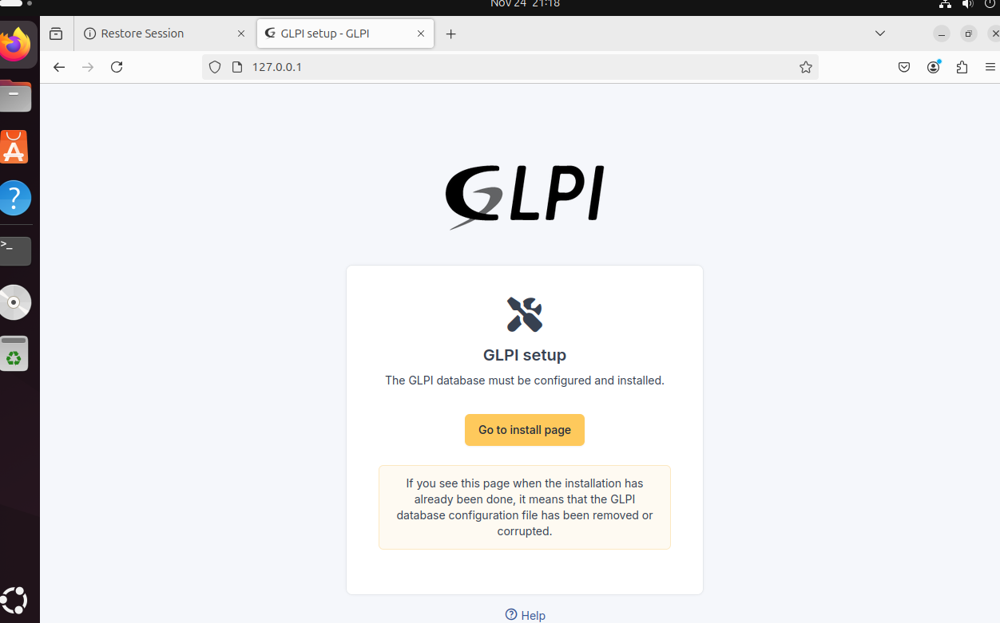
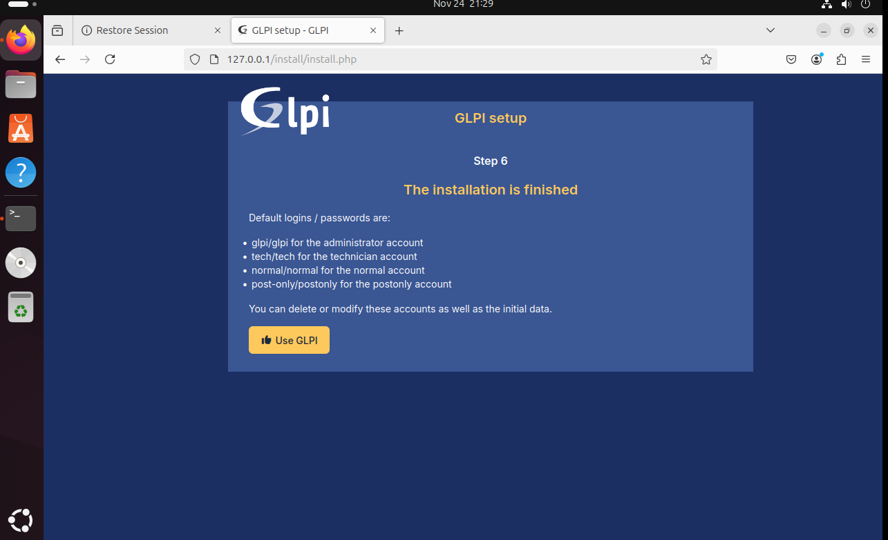
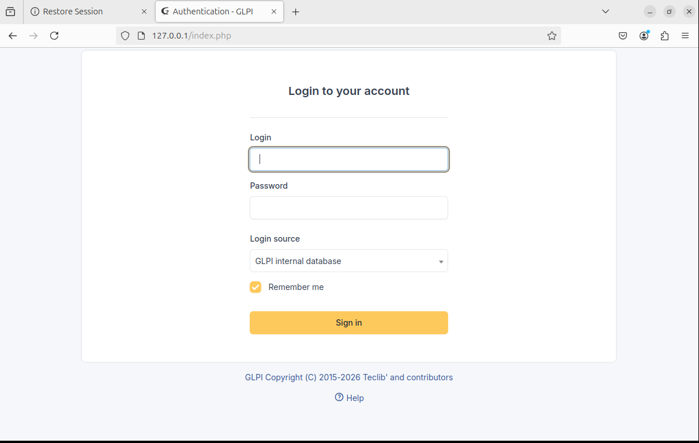
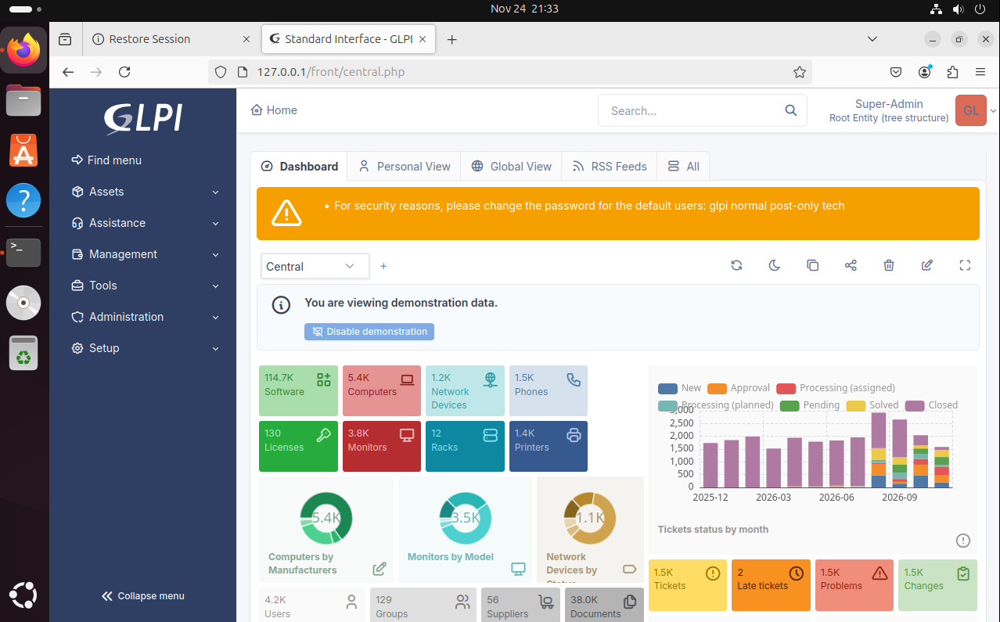
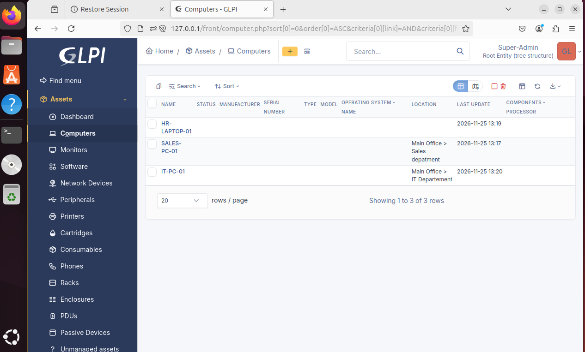
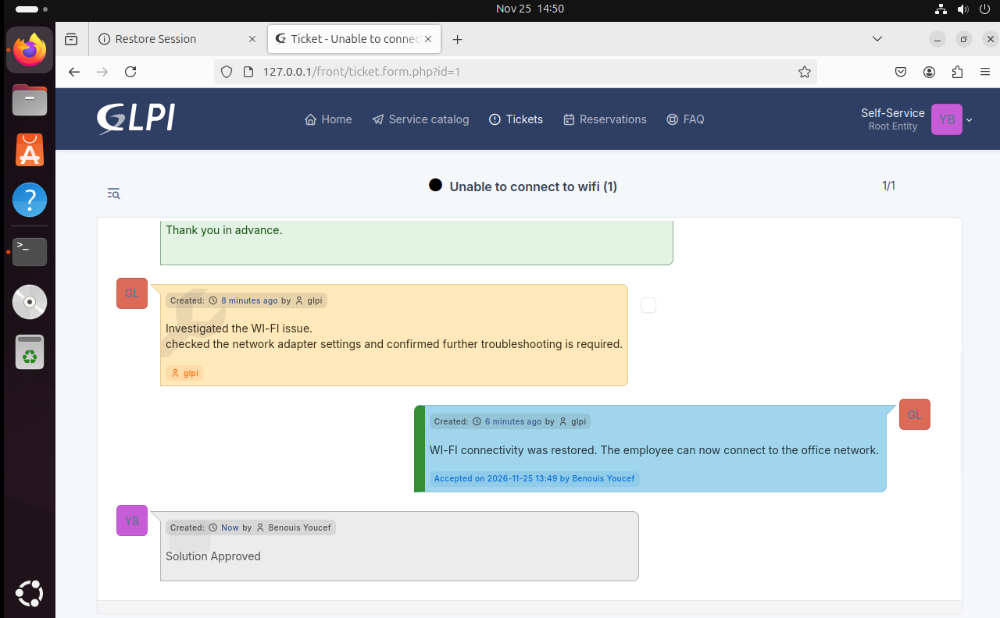

# GLPI Helpdesk & IT Asset Management

### MOHTECH Solutions | IT Support & Infrastructure


---

## Overview

I built this project to get hands-on experience deploying and managing a helpdesk system using GLPI.

I started by setting up an Ubuntu virtual machine in VMware Workstation, installing the required web server and database components, and deploying GLPI. Once everything was running, I configured departments, created user accounts, added company equipment to the inventory, and tested the ticketing workflow.

The project is based on a MOHTECH Solutions company scenario and focuses on tasks commonly handled by an IT support team.

## Technology Stack

| Technology | Purpose |
|---|---|
| Ubuntu Desktop 24.04.5 LTS | Operating system |
| GLPI 12.0.2 | Helpdesk and asset management |
| Apache2 | Web server |
| PHP 8.3.6 | Application runtime |
| MariaDB 10.11.14 | Database |
| VMware Workstation | Virtualization |
| Bridged Networking | Network connectivity |

## Infrastructure Architecture

I deployed GLPI on an Ubuntu virtual machine. Apache2 handles incoming web requests, PHP runs the application, and MariaDB stores its data.

```text
             MOHTECH SOLUTIONS
              Employees / IT
                    |
               Web Browser
                    |
             Ubuntu Linux VM
                GLPI 12.0.2
                    |
                 Apache2
                    |
                   PHP
                    |
                 MariaDB
               GLPI Database
```

---

# 1. Linux Environment & Server Deployment

I created an Ubuntu Desktop 24.04.5 LTS virtual machine using VMware Workstation.

I configured its network adapter in bridged mode so the VM could communicate with devices on my local network.

## 1.1 Apache2 Web Server

I installed Apache2 to host GLPI and checked that it was working by accessing the default Apache page.


I then configured a dedicated Apache VirtualHost for GLPI.

I set the DocumentRoot to:

`/var/www/glpi/public`

This points Apache to GLPI's public directory instead of exposing the entire application directory.

## 1.2 Web Server and Database Services

I installed MariaDB to provide the database required by GLPI.

I checked that both Apache2 and MariaDB services were running.


## 1.3 MariaDB Database Configuration

I created a dedicated database and user for the GLPI installation.

| Setting | Value |
|---|---|
| Database Server | MariaDB |
| Database Name | `glpi` |
| Database User | `glpi_user` |
| Purpose | GLPI application data |

I verified that the database had been created successfully.


Database credentials are not included in this repository.

## 1.4 PHP Installation

I installed PHP 8.3.6 along with the extensions required by GLPI.

I checked the installed PHP version before continuing with the deployment.


## 1.5 GLPI Application Deployment

I downloaded and extracted GLPI 12.0.2 into:

`/var/www/glpi`


I configured the directory ownership and permissions for Apache's service account, `www-data`, so the web server could access the required GLPI files and directories.


## 1.6 Apache VirtualHost & Local Access

I configured the Apache VirtualHost to serve GLPI through its public directory.

I then accessed the application locally to check that the web server configuration was working.



## 1.7 GLPI Installation

I opened the GLPI installer and checked that the required environment checks were passing before connecting it to MariaDB.


I connected GLPI to the database I had created and completed the installation.



## 1.8 GLPI Login & Dashboard

After completing the installation, I accessed the GLPI login page.



I logged in successfully and reached the GLPI dashboard.



---

# 2. Organizational Structure & User Management

I configured the organizational structure in GLPI to represent the different departments at MOHTECH Solutions.

## 2.1 Locations and Departments

I created a location hierarchy under the Main Office:

```text
Main Office
|
|-- IT Department
|
|-- HR Department
|
|-- Sales Department
```

I used these locations when assigning users and equipment.


## 2.2 User Accounts

I created three accounts for the HR, Sales, and IT departments.

| Username | Name shown in GLPI | Email | Department | Access |
|---|---|---|---|---|
| `youcef.hr` | Benouis | `benouisyoucef.hr@mohtechsolutions.com` | HR | Self-Service |
| `youness.sales` | Mansour | `mansouryouness.sales@mohtechsolutions.com` | Sales | Self-Service |
| `ahmed.it` | Khalil | `khalilahmed.it@mohtechsolutions.com` | IT | Hotliner + Technician authorization |

I assigned each account to its department and configured the appropriate access.


## 2.3 Employee Self-Service Access

I logged in using the HR employee account to check the Self-Service interface.

Employees can use this interface to submit and follow up on their support requests without accessing the IT administration interface.


---

# 3. IT Asset Management

I added company equipment to the GLPI inventory and associated each asset with its department and assigned user.

The inventory contains three computers and one printer.

## 3.1 Computer Registration

I registered the computers and assigned them to the appropriate employees.



## 3.2 Complete Asset Inventory

Here is the inventory after adding all four assets.

| Asset | Location | Assigned User | Asset ID |
|---|---|---|---|
| `HR-LAPTOP-01` | HR Department | Youcef Benouis (`youcef.hr`) | `MOH-LAP-001` |
| `SALES-PC-01` | Sales Department | Youness Mansour (`youness.sales`) | `MOH-PC-001` |
| `IT-PC-01` | IT Department | Ahmed Khalil (`ahmed.it`) | `MOH-PC-002` |
| `MAIN-OFFICE-PRINTER-01` | Main Office | Ahmed Khalil (`ahmed.it`) | `MOH-PRN-001` |

### Inventory Summary

| Asset Type | Quantity |
|---|---:|
| Computers | 3 |
| Printers | 1 |
| **Total Assets** | **4** |


---

# 4. IT Ticket Categories

I created five ticket categories to organize incoming support requests.

| Category | Code | Description |
|---|---|---|
| Hardware | HW | Computer and hardware-related issues |
| Software | SW | Operating system and application issues |
| Network | NET | Network connectivity problems |
| Accounts & Access | ACC | User accounts and access issues |
| Printers | PRN | Printer and printing problems |


---

# 5. Helpdesk & Incident Management

After configuring the users, assets, and ticket categories, I tested the helpdesk workflow using the HR employee account and the IT technician account.

## 5.1 Employee Incident Submission

I logged in as Youcef (`youcef.hr`) and submitted a network incident through the Self-Service interface.

### Ticket Details

| Field | Value |
|---|---|
| Requester | Youcef Benouis |
| Username | `youcef.hr` |
| Type | Incident |
| Category | Network |
| Associated Asset | `HR-LAPTOP-01` |
| Assigned Technician | Ahmed Khalil (`ahmed.it`) |
| Title | Unable to connect to office Wi-Fi |

### Reported Problem

> My HR laptop cannot connect to the office Wi-Fi. Other employees appear to be connected normally. Please investigate.

I associated the ticket with Youcef's laptop and assigned it to Ahmed for investigation.


## 5.2 Technician Assignment & Investigation

I switched to the IT technician account and handled the assigned ticket.

I added a task to document the troubleshooting activity.

### Troubleshooting Activity

> Investigated the reported Wi-Fi connectivity issue. Checked the laptop's network adapter and confirmed that further network troubleshooting is required.


## 5.3 Solution & Ticket Closure

After troubleshooting, I added a solution to the ticket.

### Documented Solution

> Wi-Fi connectivity was restored after troubleshooting the laptop's network connection. Youcef can now connect to the office network successfully.

I then logged back in as the employee, reviewed the proposed solution, and approved it. The ticket reached **Closed** status.

### Ticket Lifecycle

```text
Employee submits incident
          |
          v
Ticket created in GLPI
          |
          v
Assigned to IT technician
          |
          v
Technician investigates
          |
          v
Troubleshooting documented
          |
          v
Solution added
          |
          v
Employee approves solution
          |
          v
Ticket closed
```



---

# 6. Technical Skills

### Linux Administration
- Ubuntu Linux installation and configuration.
- Linux command-line administration.
- Service management using `systemctl`.
- Application directory ownership and permissions.
- Linux package installation and management.

### Web Server Administration
- Apache2 installation and configuration.
- Apache VirtualHost configuration.
- DocumentRoot configuration.
- Apache module management.
- Hosting a PHP-based web application.

### Database Administration
- MariaDB installation and service management.
- Database creation and verification.
- Dedicated application database user configuration.
- Web application database connectivity.

### IT Support & Helpdesk
- GLPI deployment and configuration.
- User account and authorization management.
- Organizational location management.
- IT asset inventory management.
- Ticket categorization and assignment.
- Incident troubleshooting documentation.
- Solution management and ticket closure.

### IT Infrastructure
- VMware Workstation virtual machine deployment.
- Bridged networking configuration.
- Linux-hosted application deployment.
- Integration of Apache2, PHP, and MariaDB.
