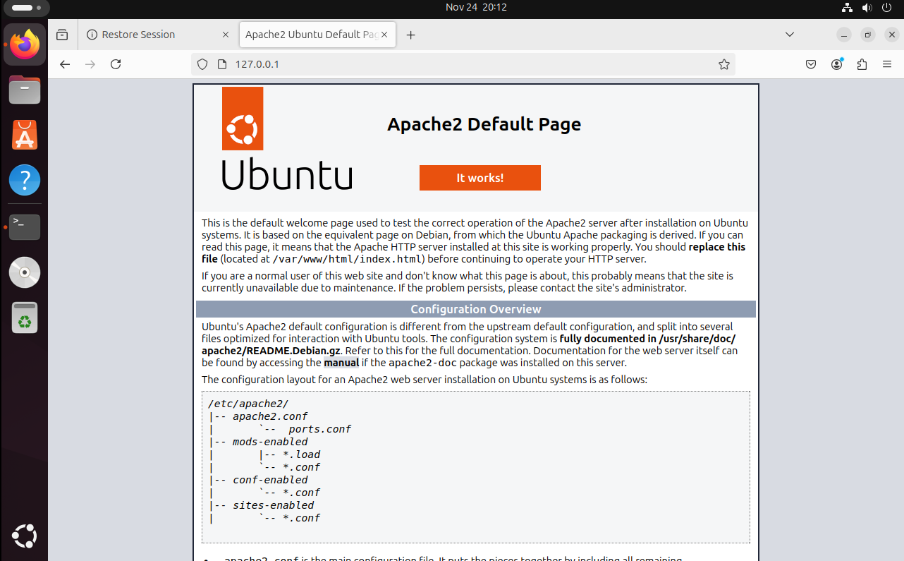
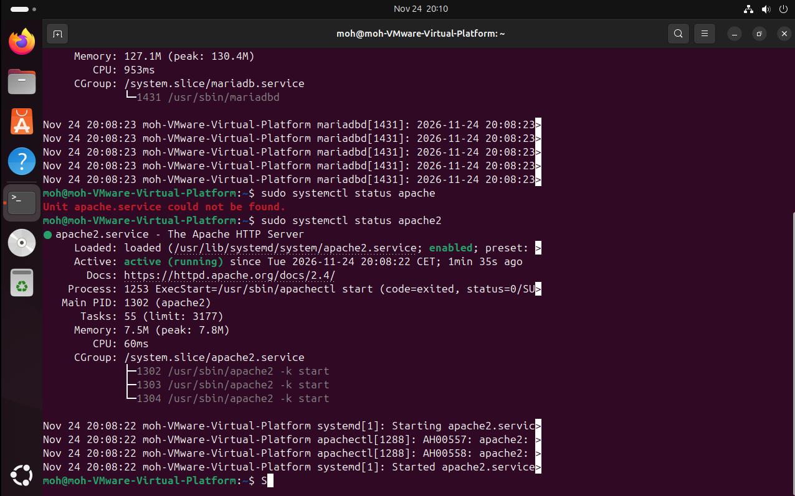
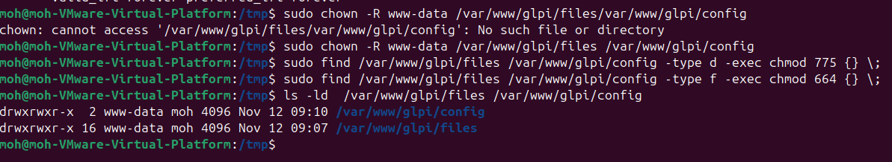
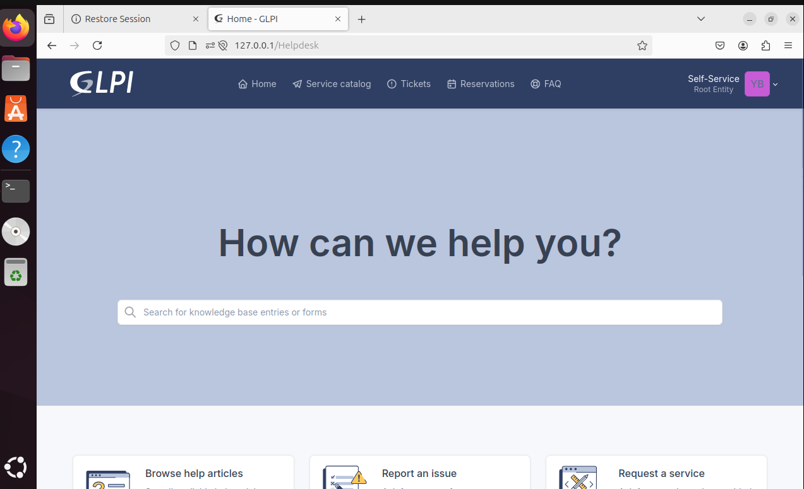
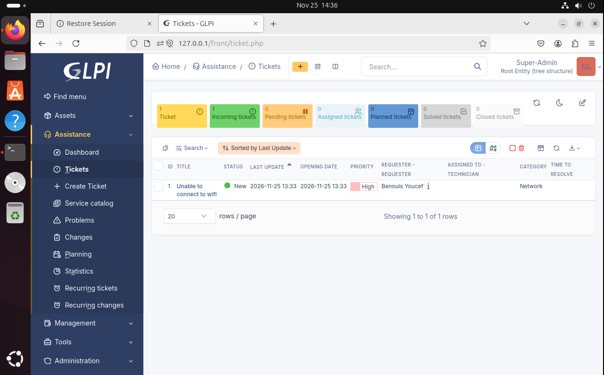

# GLPI Helpdesk & IT Asset Management

### MOHTECH Solutions | IT Support & Infrastructure


---

## Overview

This project started as a way to get hands-on experience with GLPI and the kind of tasks involved in managing an organization's IT support environment.

The setup includes an Ubuntu virtual machine running GLPI, with Apache2, PHP, and MariaDB handling the application. After getting the platform up and running, I configured departments and user accounts, added company equipment to the inventory, and tested the ticketing workflow.

The project is based on a MOHTECH Solutions company scenario.

## Technology Stack

| Technology | Purpose |
|---|---|
| Ubuntu Desktop 24.04.5 LTS | Operating system |
| GLPI 12.0.2 | Helpdesk and asset management |
| Apache2 | Web server |
| PHP 8.3.6 | Application runtime |
| MariaDB 10.11.14 | Database |
| VMware Workstation | Virtualization |
| Bridged Networking | Network connectivity |

## Infrastructure Architecture

GLPI runs on an Ubuntu virtual machine. Apache2 handles incoming web requests, PHP runs the application, and MariaDB stores its data.

```text
             MOHTECH SOLUTIONS
              Employees / IT
                    |
               Web Browser
                    |
             Ubuntu Linux VM
                GLPI 12.0.2
                    |
                 Apache2
                    |
                   PHP
                    |
                 MariaDB
               GLPI Database
```

---

# 1. Linux Environment & Server Deployment

The environment was built using an Ubuntu Desktop 24.04.5 LTS virtual machine in VMware Workstation.

The network adapter was configured in bridged mode to allow the VM to communicate with devices on the local network.

## 1.1 Apache2 Web Server

Apache2 was installed to host the GLPI web application. Its default page was accessed to verify that the web server was working.



A dedicated Apache VirtualHost was then configured for GLPI.

The DocumentRoot was set to:

`/var/www/glpi/public`

This directs Apache to GLPI's public directory rather than exposing the entire application directory.

## 1.2 Web Server and Database Services

MariaDB was installed as the database server required by GLPI.

Both Apache2 and MariaDB services were checked to confirm they were running.



## 1.3 MariaDB Database Configuration

A dedicated database and user were created for the GLPI installation.

| Setting | Value |
|---|---|
| Database Server | MariaDB |
| Database Name | `glpi` |
| Database User | `glpi_user` |
| Purpose | GLPI application data |

The database was verified through the MariaDB command-line interface.


Database credentials are not included in this repository.

## 1.4 PHP Installation

PHP 8.3.6 was installed along with the extensions required by GLPI.


## 1.5 GLPI Application Deployment

GLPI 12.0.2 was downloaded and extracted into:

`/var/www/glpi`


The application directory ownership and permissions were configured for Apache's service account, `www-data`, allowing the web server to access the required GLPI files and directories.



## 1.6 Apache VirtualHost & Local Access

The Apache VirtualHost was configured to serve GLPI through its public directory.

The application was then accessed locally to verify the web server configuration.


## 1.7 GLPI Installation

The GLPI installer was opened and the environment requirements were checked before connecting the application to MariaDB.


After connecting GLPI to the previously created database, the installation was completed.


## 1.8 GLPI Login & Dashboard

The GLPI login page was accessed after installation.


The first successful login led to the GLPI dashboard.


---

# 2. Organizational Structure & User Management

GLPI was configured to reflect the organizational structure of MOHTECH Solutions.

## 2.1 Locations and Departments

A location hierarchy was created under the Main Office:

```text
Main Office
|
|-- IT Department
|
|-- HR Department
|
|-- Sales Department
```

These locations are used when assigning users and equipment.


## 2.2 User Accounts

Three accounts were created for the HR, Sales, and IT departments.

| Username | Name shown in GLPI | Email | Department | Access |
|---|---|---|---|---|
| `youcef.hr` | Benouis | `benouisyoucef.hr@mohtechsolutions.com` | HR | Self-Service |
| `youness.sales` | Mansour | `mansouryouness.sales@mohtechsolutions.com` | Sales | Self-Service |
| `ahmed.it` | Khalil | `khalilahmed.it@mohtechsolutions.com` | IT | Hotliner + Technician authorization |

Each account was assigned to its department with the appropriate access configuration.


## 2.3 Employee Self-Service Access

The HR employee account was used to verify access to the Self-Service interface.

Employees can use this interface to submit and follow up on support requests without accessing the IT administration interface.



---

# 3. IT Asset Management

The GLPI inventory was populated with company equipment, with each asset associated with its department and assigned user.

The inventory contains three computers and one printer.

## 3.1 Computer Registration

Three computer assets were registered and assigned to the appropriate employees.


## 3.2 Complete Asset Inventory

The completed inventory contains the following assets:

| Asset | Location | Assigned User | Asset ID |
|---|---|---|---|
| `HR-LAPTOP-01` | HR Department | Youcef Benouis (`youcef.hr`) | `MOH-LAP-001` |
| `SALES-PC-01` | Sales Department | Youness Mansour (`youness.sales`) | `MOH-PC-001` |
| `IT-PC-01` | IT Department | Ahmed Khalil (`ahmed.it`) | `MOH-PC-002` |
| `MAIN-OFFICE-PRINTER-01` | Main Office | Ahmed Khalil (`ahmed.it`) | `MOH-PRN-001` |

### Inventory Summary

| Asset Type | Quantity |
|---|---:|
| Computers | 3 |
| Printers | 1 |
| **Total Assets** | **4** |


---

# 4. IT Ticket Categories

Five ticket categories were created to organize incoming support requests.

| Category | Code | Description |
|---|---|---|
| Hardware | HW | Computer and hardware-related issues |
| Software | SW | Operating system and application issues |
| Network | NET | Network connectivity problems |
| Accounts & Access | ACC | User accounts and access issues |
| Printers | PRN | Printer and printing problems |


---

# 5. Helpdesk & Incident Management

With the users, assets, and ticket categories in place, the next step was to test the helpdesk workflow using the HR employee account and the IT technician account.

## 5.1 Employee Incident Submission

To test ticket submission, I logged in as Youcef (`youcef.hr`) and reported a network connectivity issue through the Self-Service interface.

### Ticket Details

| Field | Value |
|---|---|
| Requester | Youcef Benouis |
| Username | `youcef.hr` |
| Type | Incident |
| Category | Network |
| Associated Asset | `HR-LAPTOP-01` |
| Assigned Technician | Ahmed Khalil (`ahmed.it`) |
| Title | Unable to connect to office Wi-Fi |

### Reported Problem

> My HR laptop cannot connect to the office Wi-Fi. Other employees appear to be connected normally. Please investigate.

The ticket was associated with Youcef's laptop and assigned to Ahmed for investigation.



## 5.2 Technician Assignment & Investigation

The ticket was handled through the IT technician account.

A task was added to record the troubleshooting activity.

### Troubleshooting Activity

> Investigated the reported Wi-Fi connectivity issue. Checked the laptop's network adapter and confirmed that further network troubleshooting is required.


## 5.3 Solution & Ticket Closure

After troubleshooting, a solution was added to the ticket.

### Documented Solution

> Wi-Fi connectivity was restored after troubleshooting the laptop's network connection. Youcef can now connect to the office network successfully.

The proposed solution was reviewed and approved through the employee account, and the ticket reached **Closed** status.

### Ticket Lifecycle

```text
Employee submits incident
          |
          v
Ticket created in GLPI
          |
          v
Assigned to IT technician
          |
          v
Technician investigates
          |
          v
Troubleshooting documented
          |
          v
Solution added
          |
          v
Employee approves solution
          |
          v
Ticket closed
```


---

# 6. Technical Skills

### Linux Administration
- Ubuntu Linux installation and configuration.
- Linux command-line administration.
- Service management using `systemctl`.
- Application directory ownership and permissions.
- Linux package installation and management.

### Web Server Administration
- Apache2 installation and configuration.
- Apache VirtualHost configuration.
- DocumentRoot configuration.
- Apache module management.
- Hosting a PHP-based web application.

### Database Administration
- MariaDB installation and service management.
- Database creation and verification.
- Dedicated application database user configuration.
- Web application database connectivity.

### IT Support & Helpdesk
- GLPI deployment and configuration.
- User account and authorization management.
- Organizational location management.
- IT asset inventory management.
- Ticket categorization and assignment.
- Incident troubleshooting documentation.
- Solution management and ticket closure.

### IT Infrastructure
- VMware Workstation virtual machine deployment.
- Bridged networking configuration.
- Linux-hosted application deployment.
- Integration of Apache2, PHP, and MariaDB.
